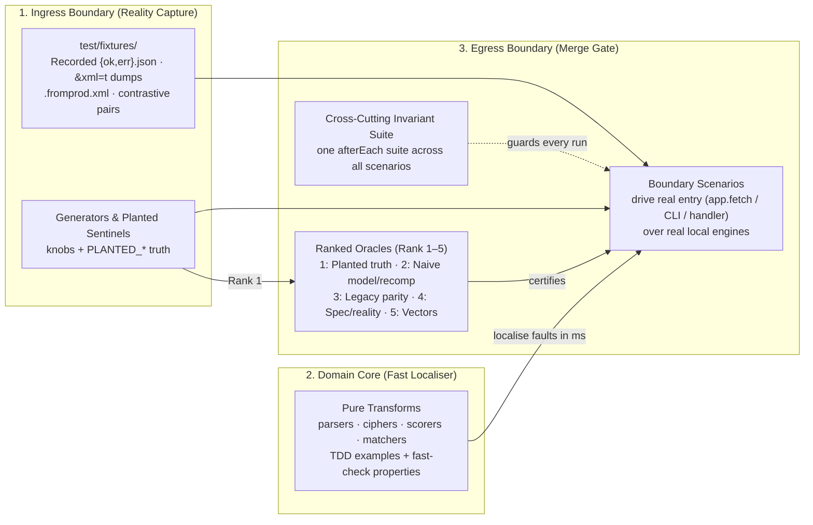

# Dual-Boundary (Reality-and-Oracle) Verification

> **Tagline**: *True-up the ingress boundary against captured reality; verify the core as pure transforms; certify the egress boundary with ranked oracles and universal invariants.*

## Why Conventional Testing Breaks in the Agentic Era

The traditional test pyramid (hundreds of mocked unit tests, some integration tests, a handful of slow E2E tests) was an economic compromise for human labor: black-box harnesses were expensive to write by hand, so developers wrote cheap mocked unit tests and relied on human code review to catch integration drift.

In the age of coding agents, that compromise is actively harmful:
1. **The Tautology Trap**: When an agent writes both `src/` and `test/` using mocks (`vi.mock`), it encodes the exact same hallucinated assumption or bug on both sides of the assertion. The suite turns green while certifying nothing.
2. **Boundaries Are Where Risk Lives**: In real systems (cloud runtimes, ERPs like NetSuite, OAuth/MCP protocols), 90% of bugs live at the external boundary—undocumented payload shapes, `'T'` vs `true`, sequence numbers masquerading as internal IDs, or secret placeholders resolving as literal strings. Hand-written mocks erase those sharp edges.
3. **The Cybernetic Fix Loop**: Because agents make writing and running black-box boundary suites cheap, the test suite becomes an **autonomous control loop**. When a scenario fails, the agent receives `{ failure + spec + invariants }` and iterates until green—freeing humans from reading glue diffs so they can govern **Scenario Tables, Ranked Oracles, and adversarial Probes**.

This reference defines **what we test instead**, organized by the **nature of the code** and anchored at **two boundaries** with **pure transforms** in between.

---

## 1. The Three-Layer Anatomy



### Layer 1: Ingress Boundary — Captured Reality (`test/fixtures/` & True-Up)
In integration-heavy systems, 90% of defects live in the gap between what the developer/agent *believes* an external system returns and what it *actually* returns.
- **Capture first, code second**: Before writing an adapter or refactoring a legacy module, capture real boundary artifacts into `test/fixtures/` (or `docs/prod-import/`):
  - **HTTP / API edges**: Run a one-off recorder script (`scripts/record-fixtures.ts`) against a test account to save `test/fixtures/<service>/<endpoint>.{ok,err}.json` (one success + one error per endpoint), replacing live tokens/PII with `PLANTED_*` sentinels.
  - **Platform records & configs (e.g., NetSuite / ERP / CRM)**: Pull real record instances (`?id=<id>&xml=t`), SuiteQL JSON dumps with all raw columns/nulls, and live deployed script/object XML (`suitecloud object:import` / `file:import` → `*.fromprod.xml`) to true-up against production drift before editing.
- **Contrastive Fixture Pairs (Differential Ingress)**: Capture **pairs** from reality whose difference defines the behavior:
  - `with-feature.xml` vs. `without-feature.xml`
  - `<endpoint>.ok.json` vs. `<endpoint>.err.json`
  - A real record manually put into the target post-state by an admin in production (golden target fixture).
- **Document any fixture trimming**: If a massive payload (e.g., an 80-tier price book) is trimmed for readability, include a `fixtures/<domain>/README.md` stating exactly what was trimmed and proving via arithmetic/structural assertions that the conserved quantities still foot to the header.

### Layer 2: Domain Core — Pure Transforms (Fast Localiser)
A failing black-box scenario tells you *that* something broke; a failing pure-transform test tells you *where*, in milliseconds.
- **Peel decision logic out of hostile runtimes**: Keep runtime SDKs (`N/record`, `N/search`, cloud clients, HTTP frameworks) in a thin outer shell. Extract parsing, scoring, key encoding, cryptography, and business matching into pure functions taking plain data shaped like your captured fixtures.
- **TDD + Property-Based Testing**: Write example tests (and published test vectors, e.g., RFC 7636 PKCE) via red–green TDD, then add `fast-check` / `Hypothesis` properties (round-trip, idempotence, monotonicity, tamper rejection).
- **Never unit-test glue**: Delete unit tests of runners, CLI wiring, or handler orchestration in favor of boundary scenarios.

### Layer 3: Egress Boundary — Scenarios, Ranked Oracles & Invariant Sweep (Merge Gate)
- **Scenarios at the real boundary**: Drive the system through the exact entry point a real caller uses (`app.fetch(new Request(...))`, CLI `main()`, webhook handler) over real local engines (real SQLite/DuckDB/DenoKV/filesystem, real parsers).
- **Ranked Oracles (Rank 1–5 certify; Rank 6–7 guard)**:

| Rank | Oracle | Use When | Sufficient Alone? |
|------|--------|----------|-------------------|
| **1** | **Planted truth** — generator or fixture planted N items or `PLANTED_*` sentinels; code must find N (or never leak `PLANTED_*`) | Pipelines, clustering, multi-tenant isolation, security boundaries | **Yes** |
| **2** | **Independent recomputation / Naive model** — a second, simpler computation over raw input (an in-test `Map`, SQL/pandas over raw rows, header footing identity `total = sub - margin - adj + tax`) | Stateful stores, aggregations, financial/accounting pipelines | **Yes** |
| **3** | **Legacy parity** — verbatim old code kept under `test/legacy_ref/` run on the same input | Ports, crypto/storage migrations, refactors | **Yes** (for ported scope) |
| **4** | **Recorded reality / Spec contract** — captured responses + RFC/protocol state machine rules | Boundary handlers, OAuth flows, API adapters | **Yes** (for contract shape) |
| **5** | **Published vector / Hand-computed example** | Pure transforms (PKCE, hashing, date math) | **Yes** (paired with properties) |
| **6** | **Cross-cutting Invariants** — one suite parametrised over every scenario | Every scenario, always | **No** (Guard only) |
| **7** | **Goldens / Phase 0 Characterisation** — byte-for-byte recorded outputs | Pre-refactor safety net; rendering pipelines | **No** (Guard only) |

---

## 2. Classify Code by Nature First

| Nature | Boundary to Test Through | Suite Shape | Primary Oracle |
|--------|--------------------------|-------------|----------------|
| **Pure transform** | Function signature | TDD examples/vectors + `fast-check` / `Hypothesis` properties | Rank 5 (vectors/examples) + properties + Rank 3 (legacy parity if porting) |
| **Deterministic pipeline** | CLI or entry function with seeded input dir | Scenario suite over generated/captured inputs + invariant suite | Rank 1 (planted truth) + Rank 2 (independent recomputation) |
| **Boundary handler** | Platform entry (`app.fetch`, webhook, resolver) | Scenario per situation (success, each error path, auth failure, replay) with third-party edge replayed from `test/fixtures/` | Rank 4 (recorded reality + spec) + Rank 1 (planted isolation) |
| **Stateful store access** | `Store` public API (`runStoreSuite`) | One shared contract + model suite run against every backend (in-memory, file, cloud emulator) | Rank 2 (`fast-check` command sequences vs. in-test `Map` model) + read-after-write |

---

## 3. Protocol When No Spec or Plan Exists

Scenarios trace to a **Scenario Table** (`Scenario · Boundary · Fixture/Generator · Oracle · Assertions`) in `./docs/specs/` or `./docs/plans/`. Never invent tests directly from implementation code:

1. **New feature, no spec/plan**: Draft the Scenario Table from the request first and confirm it before writing code.
2. **Bug fix**: The bug report *is* the scenario. Reproduce it as a failing boundary scenario first, fix the code, and check whether a cross-cutting invariant should be added.
3. **Untested legacy codebase (Phase 0 Characterisation)**: Run existing code against recorded fixtures and save outputs under `test/characterisation/` **explicitly labelled as characterisation, not certification**. Delete each characterisation golden as the scenario + oracle certifying that behavior lands.

---

## 4. Thin Abstractions & Copy-Pasteable Implementations (`test/support/`)

Avoid heavy mocking frameworks. Four thin files (~150 lines total) implement the entire architecture:

### A. Injectable `TestClock` (`test/support/clock.ts` — 10 lines)
Never sleep in tests or depend on wall-clock `Date.now()`. Inject `clock: () => number` into app dependencies.

```ts
export class TestClock {
  private t = Date.UTC(2026, 0, 1);
  now = (): number => this.t;
  advance(ms: number): void { this.t += ms; }
  set(ms: number): void { this.t = ms; }
}
```

### B. Planted Truth Sentinels (`test/support/planted.ts` — 10 lines)
Use recognizable non-secret sentinel values across fixtures and configs so both scenarios and the invariant scanner can detect leaks.

```ts
export const PLANTED_CLIENT_ID = "planted-client-id";
export const PLANTED_CLIENT_CREDENTIAL = ["planted", "client", "credential"].join("-");
export const PLANTED_KEY_MATERIAL = "0".repeat(64);
export const PLANTED_TOKEN_PATTERN = /PLANTED_UPSTREAM_(ACCESS|REFRESH)_[A-Z0-9_]+/g;
```

### C. Boundary Recording Wrapper & `afterEach` Invariant Sweep (`test/support/invariants.ts` + `invariants-setup.ts`)
Wrap the boundary (`app.fetch`) inside `startTestServer()` so every HTTP response, console log line, and backing-store state is automatically checked after **every** test without per-test boilerplate:

```ts
// test/support/invariants.ts
import { expect } from "vitest";
import { PLANTED_TOKEN_PATTERN } from "./planted.js";

export type RecordedResponse = {
  path: string;
  status: number;
  headers: Headers;
  body: string;
  issuesTokens: boolean;
};

export type ServerRecord = {
  dumpStore: () => Promise<unknown>;
  responses: RecordedResponse[];
  secrets: Set<string>;
};

const servers: ServerRecord[] = [];
export const logs: string[] = [];

export function track(rec: ServerRecord): void { servers.push(rec); }
export function takeTracked(): ServerRecord[] { return servers.splice(0, servers.length); }

export function recordingFetch(
  fetchFn: (req: Request) => Response | Promise<Response>,
  rec: ServerRecord,
): (req: Request) => Promise<Response> {
  return async (req: Request) => {
    const res = await fetchFn(req);
    const path = new URL(req.url).pathname;
    const body = await res.clone().text();
    const issuesTokens = path === "/token" && res.status === 200;
    if (issuesTokens) {
      try {
        const j = JSON.parse(body);
        for (const k of ["access_token", "refresh_token"]) {
          if (typeof j[k] === "string") rec.secrets.add(j[k]);
        }
      } catch { /* non-JSON */ }
    }
    rec.responses.push({ path, status: res.status, headers: res.headers, body, issuesTokens });
    return res;
  };
}

export async function assertInvariants(recs: ServerRecord[], logLines: string[]): Promise<void> {
  const secrets = new Set<string>();
  for (const r of recs) for (const s of r.secrets) secrets.add(s);

  for (const rec of recs) {
    for (const res of rec.responses) {
      const where = `${res.status} ${res.path}`;
      // Invariant: no unhandled 500
      expect(res.status, `invariant (no 500): ${where}`).not.toBe(500);
      // Invariant: no secret leaked in response body
      if (!res.issuesTokens) {
        for (const s of secrets) expect(res.body.includes(s), `invariant (body secret leak): ${where}`).toBe(false);
        expect(res.body.match(PLANTED_TOKEN_PATTERN), `invariant (body planted token leak): ${where}`).toBeNull();
      }
    }
    // Invariant: no plaintext secret stored at rest
    try {
      const dump = JSON.stringify(await rec.dumpStore());
      for (const s of secrets) expect(dump.includes(s), "invariant (store holds raw secret)").toBe(false);
      expect(dump.match(PLANTED_TOKEN_PATTERN), "invariant (store holds planted token)").toBeNull();
    } catch { /* store closed by test */ }
  }
  // Invariant: no secret leaked in logs
  for (const line of logLines) {
    for (const s of secrets) expect(line.includes(s), `invariant (log secret leak): ${line}`).toBe(false);
    expect(line.match(PLANTED_TOKEN_PATTERN), `invariant (log planted token leak): ${line}`).toBeNull();
  }
}
```

Wire it once in `test/support/invariants-setup.ts`:

```ts
import { afterEach, beforeEach, vi } from "vitest";
import { assertInvariants, logs, takeTracked } from "./invariants.js";

beforeEach(() => {
  logs.length = 0;
  takeTracked();
  for (const level of ["log", "warn", "error"] as const) {
    const orig = console[level].bind(console);
    vi.spyOn(console, level).mockImplementation((...args: unknown[]) => {
      logs.push(args.map(String).join(" "));
      orig(...args);
    });
  }
});

afterEach(async () => {
  const recs = takeTracked();
  const lines = logs.splice(0, logs.length);
  vi.restoreAllMocks();
  await assertInvariants(recs, lines);
});
```

### D. Parametrised Store Suite with Model-Based Sequences (`test/store/store.suite.ts`)
Run one suite against every backend (in-memory, local file, cloud emulator) and verify random operation sequences against a naive `new Map()` oracle (Rank 2):

```ts
import { describe, expect, it } from "vitest";
import fc from "fast-check";

export function runStoreSuite(name, makeStore) {
  describe(`Store: ${name}`, () => {
    it("model_based_sequences", async () => {
      const keyArb = fc.tuple(fc.constantFrom("m", "n"), fc.constantFrom("1", "2", "3"));
      const cmdArb = fc.oneof(
        fc.record({ op: fc.constant("set"), key: keyArb, value: fc.integer() }),
        fc.record({ op: fc.constant("get"), key: keyArb }),
        fc.record({ op: fc.constant("delete"), key: keyArb }),
        fc.record({ op: fc.constant("take"), key: keyArb }),
      );
      await fc.assert(
        fc.asyncProperty(fc.array(cmdArb, { maxLength: 25 }), async (cmds) => {
          const store = await makeStore();
          const model = new Map();
          try {
            for (const c of cmds) {
              const k = c.key.join("/");
              if (c.op === "set") {
                await store.set(c.key, c.value);
                model.set(k, c.value);
              } else if (c.op === "get") {
                expect(await store.get(c.key)).toBe(model.get(k) ?? null);
              } else if (c.op === "delete") {
                await store.delete(c.key);
                model.delete(k);
              } else if (c.op === "take") {
                expect(await store.take(c.key)).toBe(model.get(k) ?? null);
                model.delete(k);
              }
            }
          } finally {
            await store.close();
          }
        }),
        { numRuns: 100 },
      );
    });
  });
}
```
