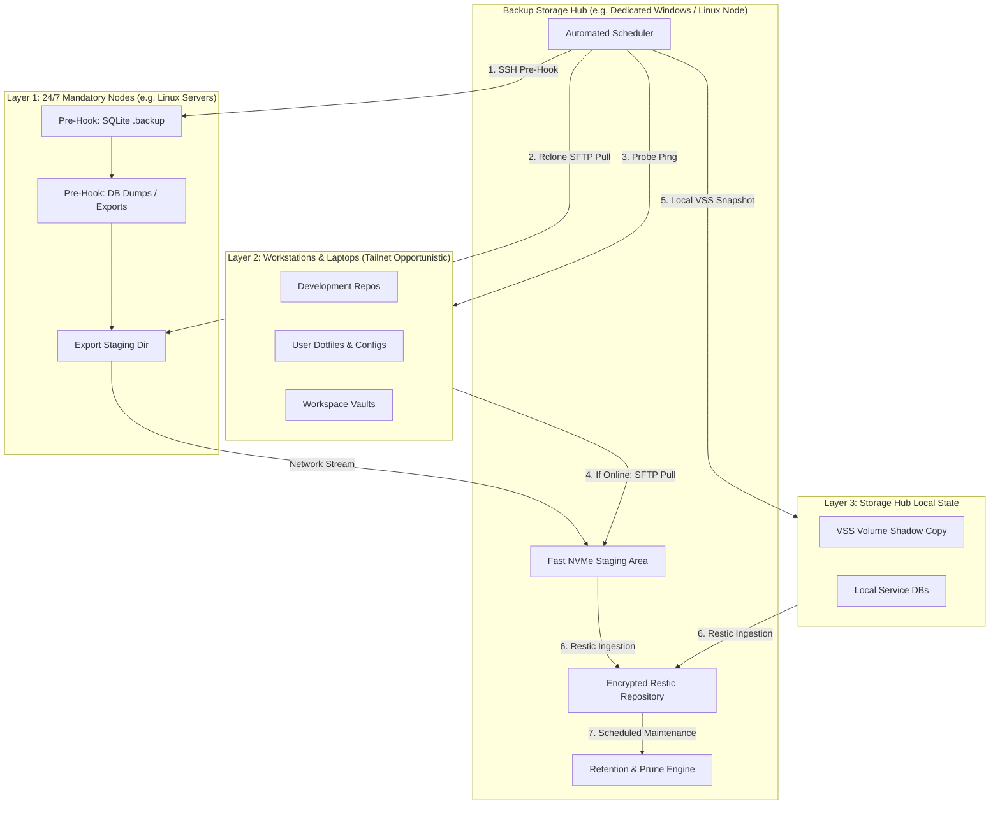

# Fleet Restic Backup

A battle-tested architecture and operational runbook for backing up heterogeneous multi-node fleets (Linux servers, Windows workstations, macOS laptops) into a single, encrypted, content-addressed `restic` repository.

Solves the distributed backup dilemma: how to achieve **strong cryptographic isolation**, **extreme deduplication across fleet hosts**, **zero-downtime database consistency**, and **unattended reliability** without paying for enterprise SaaS backup agents.

---

## 1. Fleet Topology Architecture

The architecture uses an asymmetric **Hub-and-Spoke Pull Model**:



### Why Hub-and-Spoke Over Client Push?
1. **Centralized Secret Boundary**: Remote nodes do not possess repository passwords or write access to the backup storage. If a remote edge node or workstation is compromised, the attacker cannot read or wipe the historical backup repository.
2. **Coordinated Deduplication**: Deduplication across operating systems (identical git commits, library packs, static toolchains) occurs efficiently in a single shared repository index without cross-host race conditions.
3. **Decoupled Network Staging**: Backups stream through a local high-speed NVMe staging directory before repository ingestion, ensuring restic index operations and cryptographic pack assembly run at local bus speeds.

---

## 2. The 5 Core Engineering Invariants

### Invariant 1: Zero-Downtime SQLite Pre-Hooks
**Never copy active SQLite database files (`.db`, `.sqlite`) directly during file sync.**
* Active SQLite databases in WAL (Write-Ahead Log) mode have uncheckpointed memory pages and shared memory files (`-shm`, `-wal`). Raw file copies often yield corrupted, unrecoverable databases.
* **The Solution**: Execute an atomic SQLite `.backup` call via a pre-hook script before synchronization:
  ```python
  import sqlite3
  src = sqlite3.connect("active.db")
  dst = sqlite3.connect("active.db.bak-nightly")
  src.backup(dst)
  dst.close()
  src.close()
  ```
* The source database can remain under active read/write load; the SQLite backup API guarantees an internally consistent snapshot.

### Invariant 2: Windows VSS Snapshots Under Service Accounts
**Local Windows paths with locked files must use Volume Shadow Copy (VSS).**
* Background applications (e.g. browser profiles, active editors, memory engines) hold exclusive file locks that standard file copiers fail on.
* Restic natively supports VSS on Windows via the `--use-fs-snapshot` flag.
* **Privilege Requirement**: VSS requires administrative privileges. Register the scheduled task under `NT AUTHORITY\SYSTEM` with highest privileges (`/RL HIGHEST`).
* **OpenSSH Ownership Trap**: When running scripts as `SYSTEM`, Windows OpenSSH strictly checks file *Owner* in addition to ACLs. Private keys must be owned by `SYSTEM`:
  ```powershell
  icacls id_rsa /setowner SYSTEM
  icacls id_rsa /inheritance:r
  icacls id_rsa /grant:r "SYSTEM:(R)" "Administrators:(R)"
  ```

### Invariant 3: Cross-Platform Symlink & SFTP Tolerance
**SFTP servers on Windows cannot safely traverse cross-platform relative links or directory junctions.**
* Git repositories often contain tool symlinks (e.g., `.claude/skills` or `.antigravitycli` worktree references).
* Calling `rclone` with `--links` forces it to inspect each symlink with `Lstat`/`Readlink`. Windows OpenSSH SFTP fails with `SSH_FX_BAD_MESSAGE` or `SSH_FX_FAILURE` on broken or cross-platform junction targets.
* **The Solution**: On multi-host syncs, use `--sftp-skip-links` and `--skip-links`:
  ```bash
  rclone sync remote:/path /local/staging \
    --sftp-skip-links \
    --skip-links \
    --exclude-from excludes.txt
  ```

### Invariant 4: Non-Fatal Warning Degradation
**Never let a single inaccessible file or missing optional folder abort a host's entire backup.**
* In unattended pipelines, treating any non-zero exit code as fatal causes whole-machine backups to be dropped when a single temporary file disappears during transfer.
* **Rclone Exit Handling**:
  * Exit `0`: Success.
  * Exit `1`: Partial file read warnings / unreadable locked files &rarr; Log `WARN`, **do not throw**, and proceed to `restic backup` so 99.999% of valid staged data is committed.
  * Exit `3`: Directory not found &rarr; Log `WARN` (e.g., missing optional dotfiles folder on remote host) and skip optional path.
  * Exit `2` or `>3`: Fatal syntax or connection failure &rarr; Throw.
* **Restic Exit Handling**:
  * Exit `0`: Clean snapshot created.
  * Exit `3`: Snapshot created with partial read warnings (some locked or irregular files skipped) &rarr; Log `WARN` and proceed.

### Invariant 5: Storage Controller Power Management
**External USB drives disconnect under long-running backup I/O if OS power savings are active.**
* Symptoms: Windows Event Log records `Event ID 51` (paging errors), followed by device `Code 43 - Port Reset Failed`.
* Root Cause: When `rclone` or `restic` pauses to compare large file lists, Windows triggers default aggressive idle timeouts:
  * 30-second Hard Disk Idle Timeout (`powercfg /change disk-timeout-ac 30`).
  * USB Selective Suspend.
  * USB 3.0 Root Hub power saving (`Allow computer to turn off device to save power`).
* Older external SATA-to-USB bridge chips fail the power-state wake-up handshake during I/O resumption, causing a bus drop.
* **Remediation**:
  ```powershell
  # Disable hard disk spin-down on AC and DC
  powercfg /change disk-timeout-ac 0
  powercfg /change disk-timeout-dc 0

  # Disable USB Selective Suspend
  powercfg /setacvalueindex SCHEME_CURRENT 2a737441-1930-4402-8d77-b2bebba4d5a0 48e6b7a6-50f5-4782-a5d4-53bb8f07e226 0
  powercfg /setactive SCHEME_CURRENT

  # Disable USB Root Hub power savings via Device Manager / WMI
  Get-PnpDevice -Class USB | Where-Object { $_.FriendlyName -like "*Root Hub*" }
  ```

---

## 3. Directory Layout Standards

Maintain a clean, segregated layout on the storage hub:

```
<BACKUP_ROOT>/
├── .restic-repo/             # Encrypted restic repository data and index packs
├── logs/                     # Daily run logs (backup-YYYYMMDD.log)
└── .Repository-Canary        # Zero-byte sentinel file verifying volume mount integrity

<LOCAL_PROGRAM_DATA>/
├── staging/                  # NVMe fast scratch space for remote node syncs
│   ├── node-server/
│   └── node-workstation/
├── secrets/                  # Strictly ACL-restricted credential store (0600 / SYSTEM-only)
│   ├── restic-password.txt
│   ├── rclone.conf
│   ├── id_rsa
│   └── known_hosts
└── backup.lock               # Process exclusivity PID lockfile
```

---

## 4. Standard Retention & Prune Policy

Implement a **Grandfather-Father-Son (GFS)** retention schedule that balances long-term recovery with predictable storage capacity:

| Schedule Category | Keep Rule | Purpose |
| :--- | :--- | :--- |
| **Hourly / Intraday** | `keep-hourly 24` *(optional)* | Point-in-time rollbacks for active workspaces |
| **Daily** | `--keep-daily 7` | Full weekly rollback coverage |
| **Weekly** | `--keep-weekly 5` | Month-long historical milestone coverage |
| **Monthly** | `--keep-monthly 12` | Year-long month-end archive snapshots |
| **Yearly** | `--keep-yearly 3` | Multi-year cold archival record |

### Maintenance Schedule
* **Nightly**: Run backup & light forget (`restic forget --keep-daily 7 --keep-weekly 5 ...`).
* **Bi-Weekly (Sunday 04:30)**: Run physical disk S.M.A.R.T. audit, volume check, prune, and repository integrity check:
  ```powershell
  restic prune --max-unused 5%
  restic check --read-data-subset=10%
  ```

---

## 5. Generic Reference Implementation

See [`scripts/`](./scripts/) for ready-to-deploy reference templates:
* [`fleet-backup.ps1`](./scripts/fleet-backup.ps1): Complete Windows hub backup orchestrator.
* [`backup_sqlite.py`](./scripts/backup_sqlite.py): Cross-platform atomic SQLite snapshot helper.
* [`prepare-node.sh`](./scripts/prepare-node.sh): Linux node pre-backup export hook.
* [`fleet-maintenance.ps1`](./scripts/fleet-maintenance.ps1): Retention pruning and repository verification script.
